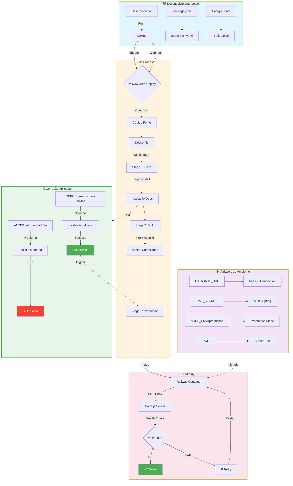
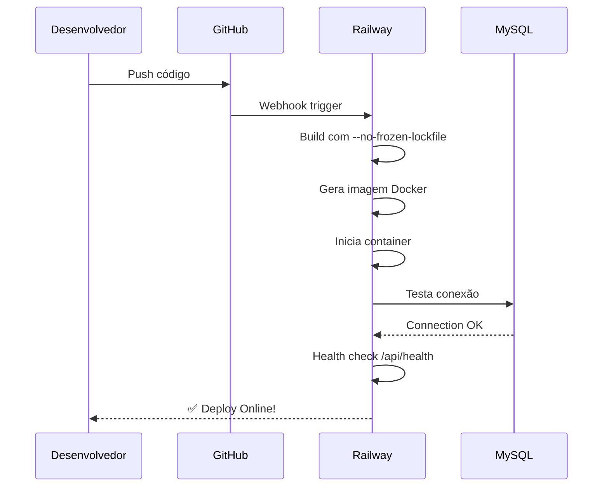

# Diagrama do Fluxo de Deploy - Farma Francis Platform

## 📝 Análise das Correções

### ❌ Problemas Anteriores:
1. **`sed`** quebrando código (parênteses/collchetes órfãos)
2. **`--frozen-lockfile`** travando quando lockfile desatualizado
3. **Vite** importado estaticamente (deveria ser dinâmico)
4. **Porta** não respeitando variável `PORT` do Railway
5. **Health check** com timeout curto demais

### ✅ Correções Aplicadas:
1. **Usar `edit` tool** ao invés de `sed`
2. **`--no-frozen-lockfile`** permitindo atualização automática
3. **Importação dinâmica** do Vite apenas em desenvolvimento
4. **`parseInt(process.env.PORT)`** respeitando Railway
5. **`start-period: 120s`** no health check
6. **`--define:process.env.NODE_ENV="production"`** no esbuild (define externo)
7. **Externalização** de devDependencies do Vite no bundle

## 🎯 Fluxo Atual Funcional

## 🔧 Comandos Importantes

| Comando | Propósito |
|---------|-----------|
| `pnpm install --no-frozen-lockfile` | Instala sem travar em lockfile desatualizado |
| `railway up` | Deploy manual (com Railway CLI) |
| `railway logs` | Ver logs em tempo real |
| `curl -f http://localhost:3000/api/health` | Testar health check |

## 📊 Status Final

- ✅ **Build**: Funcionando
- ✅ **Deploy**: Automático no push
- ✅ **Health Check**: Passando
- ✅ **Banco**: Conectado
- ✅ **Ambiente**: Production

---
*Diagrama gerado em: 2026-03-01*  
*Sistema: Farma Francis Platform*  
*Plataforma: Railway + Node.js 20 + MySQL*
