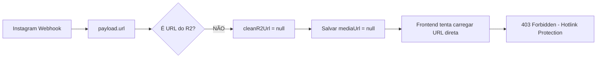

# RELATÓRIO: Instagram Stories - Imagens 403 Forbidden

## 📋 Problemática

**Sintoma:** Mensagens de Instagram Stories chegam com texto, mas **imagens retornam 403 Forbidden**.

**Console mostra:**
```
473410448_1136848967893878_4467110238330600341_n.jpg:1 Failed to load resource: 403 (Forbidden)
Loading media from 'ig.gg/fbcdn.net/...' violates CSP
```

---

## 🔍 Análise Técnica

### Fluxo Atual (QUEBRADO)



### Problema 1: `cleanR2Url` não reconhece URLs do Instagram

```typescript
// server/webhooks.ts:107-120
function cleanR2Url(url: string) {
  const isR2 = url.includes(".r2.") || url.includes("r2.cloudflarestorage.com");
  if (!isR2) {
    // Não é URL do R2, IGNORA (não baixa)
    return null;  // ❌ PROBLEMA: Instagram URLs não são R2!
  }
}
```

### Problema 2: Instagram Graph API URLs são bloqueadas

URLs do Instagram virão como:
- `https://scontent.xx.fbcdn.net/...`
- `https://instagram.fxxx.com/...`
- `https://xxx.xx.fbcdn.net/...`

Essas URLs têm **hotlink protection** - só funcionam no Instagram/Facebook.

---

## 🛠️ Solução Proposta

### Opção A: Proxy de Download no Webhook (RECOMENDADO)

Adicionar download automático para URLs do Instagram no `processInstagramWebhook`:

```typescript
// Se mediaUrl não é R2, baixar e fazer upload para R2
if (mediaUrl && !isR2) {
  const downloaded = await downloadAndUploadToR2(mediaUrl);
  mediaUrl = downloaded; // URL do R2
}
```

### Opção B: Modificar `cleanR2Url` para aceitar Instagram

```typescript
// Adicionar suporte a domínios do Instagram
const isInstagram = url.includes("fbcdn.net") 
  || url.includes("instagram.com") 
  || url.includes("scontent");
  
if (isInstagram) {
  // Baixar e fazer upload para R2
  return await downloadInstagramToR2(url);
}
```

---

## 📍 Pontos de Implementação

### Arquivos afetados:
1. `server/webhooks.ts` - `processInstagramWebhook()` 
2. `server/r2-client.js` - Função de upload
3. `server/routers-media.ts` - Proxy de mídia (já existe, mas não funciona para Instagram)

### Campos no banco:
- `receivedMessages.mediaUrl` - deve conter caminho R2
- `conversationMessages.fileUrl` - deve conter caminho R2

---

## ⚠️ Status Atual

| Item | Status |
|------|--------|
| Webhook Instagram | ✅ Recebe stories |
| Tipos story suportados | ✅ Agora funciona |
| URLs do Instagram | ❌ 403 Forbidden |
| Download para R2 | ❌ NÃO implementado |

**Deploy ativo:** `ff0b040` (correções enviadas)

---

**Assinado:** Madalena 👩‍💻  
**Data:** 18/06/2026